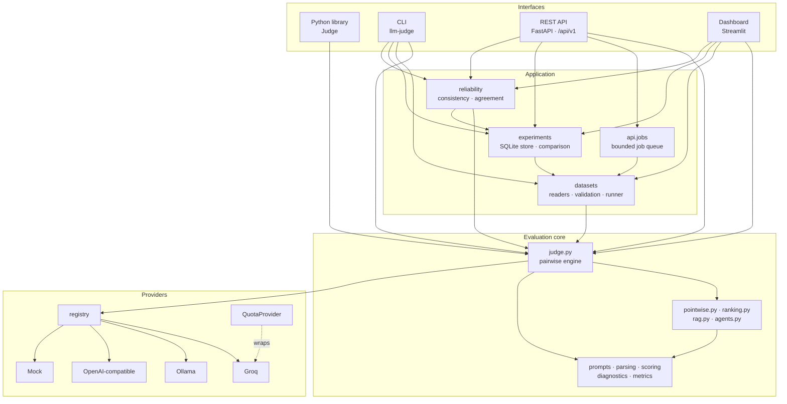
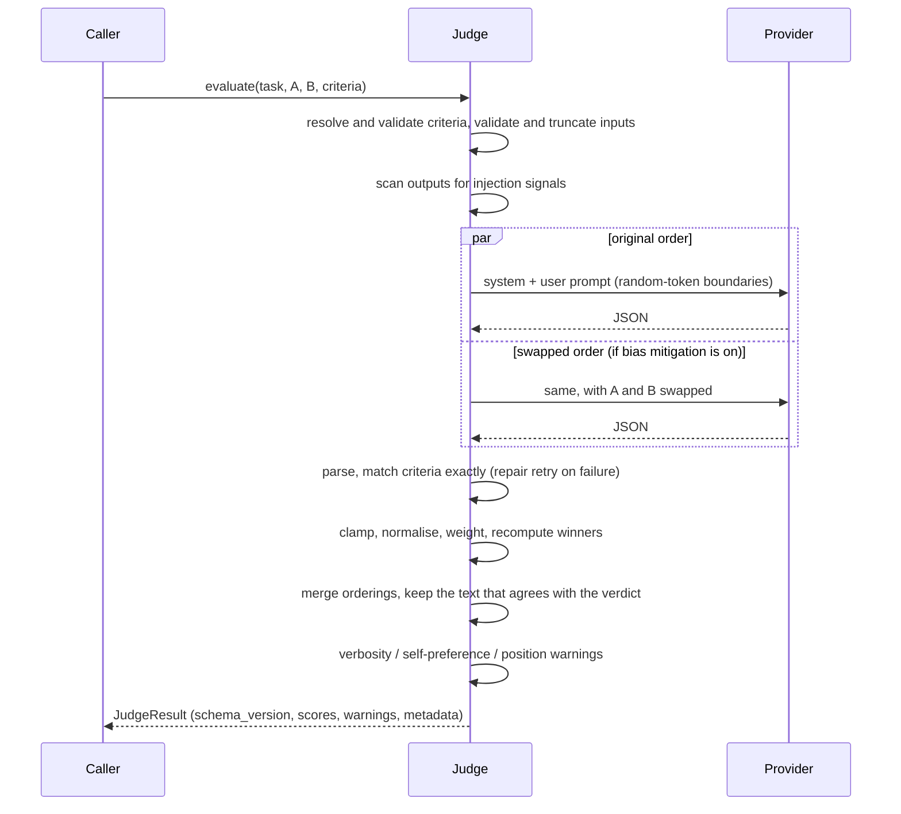

# Architecture

LLM-as-Judge is a layered system. One evaluation core is exposed through four
interfaces: the Python library, the CLI, the REST API and the Streamlit
dashboard. The core depends on no web framework, database or LLM vendor. Those
sit behind small interfaces at the edges.

## Module map

| Layer | Modules | Responsibility |
|---|---|---|
| Interfaces | `cli.py`, `api/`, `app.py` + `dashboard/` | Parse input, call the core, present results. No evaluation logic. |
| Application | `datasets/`, `experiments/`, `reliability.py`, `api/jobs.py` | Datasets at scale, persistence, statistics, background work |
| Core | `judge.py`, `pointwise.py`, `ranking.py`, `rag.py`, `agents.py` | Evaluation modes |
| Core helpers | `prompts.py`, `parsing.py`, `scoring.py`, `diagnostics.py`, `metrics.py`, `models.py`, `csv_safety.py` | Prompting, validation, arithmetic, warnings, schemas |
| Providers | `providers/` | LLM backends behind one protocol; quotas |
| Config | `config.py` | Typed settings from the environment, `.env` or Streamlit secrets |

## A pairwise evaluation, step by step

## Key design decisions

1. **One provider protocol.** A backend implements
   `complete_json(messages) -> str` and exposes `model`. Retries, repair
   retries, quotas and parsing live above it, so every provider gets the same
   policy. Health checks and usage counters are optional extras.
2. **The judge's numbers win over its words.** Winners are recomputed from
   clamped, scale-normalised, weighted scores. The LLM's stated winner is
   discarded, so a verdict can never contradict its own scores.
3. **Verdicts first, metrics second.** For RAG, the judge labels claims and
   passages, and the metrics are computed deterministically from those
   labels. Every number can be traced to specific claims.
4. **Warnings never change scores.** Suspected injection, verbosity bias,
   self-preference and order sensitivity are reported beside the scores, never
   folded into them.
5. **Untrusted content is fenced.** Inputs sit between boundary markers that
   carry an unpredictable per-request token. Text inside an input can't forge
   the end of its own block.
6. **No silent fallback.** The configured provider and model are what run,
   or the call fails with a clear error. Results always name the judge.
   Fallback to other providers exists only when explicitly configured
   (`JUDGE_FALLBACK_PROVIDERS`). Each result it touches records the provider
   that failed and the one that answered, and carries a `provider_fallback`
   warning.
7. **Free-tier first.** SQLite (standard library) for storage, an in-process
   job queue, and an offline mock judge. Every external service is optional,
   and the queue and store sit behind narrow interfaces so they can be swapped
   later.
8. **Additive schemas.** Results carry `schema_version` and the prompts carry
   `PROMPT_VERSION`, so stored runs remain interpretable as the system evolves.

## Data flow at scale

`datasets.load_dataset` validates a file (kind inference, duplicates, limits)
and returns typed records plus a report with a content fingerprint.
`DatasetRunner` evaluates them with bounded concurrency, appending each
outcome to a JSONL checkpoint so that interrupted runs resume safely.
`experiments.record_dataset_run` persists the outcomes with reproducibility
metadata, and `compare_runs` pairs rows by id to detect regressions with
confidence intervals.

## Extending

- **New provider:** implement the protocol, then register it with
  `register_provider` or the `llm_judge.providers` entry-point group.
- **New criterion:** pass a `Criterion(name, description, scale_min,
  scale_max, weight)` anywhere criteria are accepted.
- **New evaluation mode:** build on `Judge.complete_and_parse` (repair
  retries), `Judge.validate_text`, `scoring.match_criteria` and the boundary
  helpers in `prompts.py`. Follow `pointwise.py` or `rag.py` as a template.
