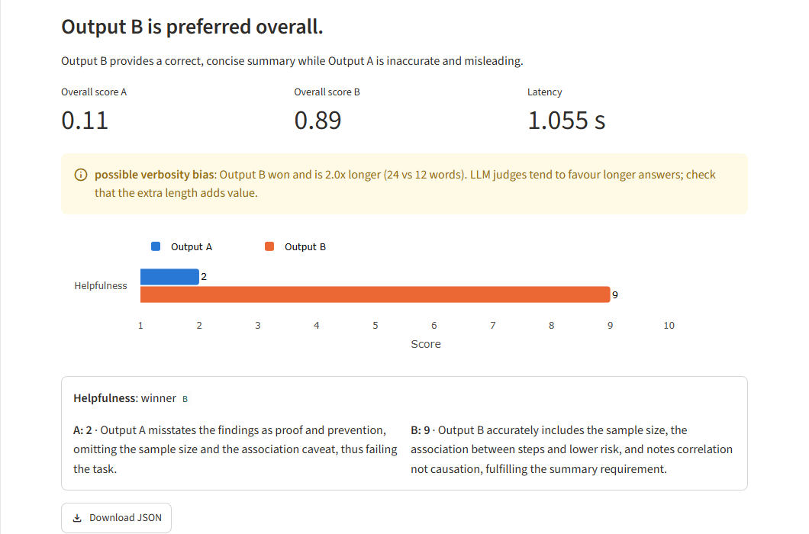
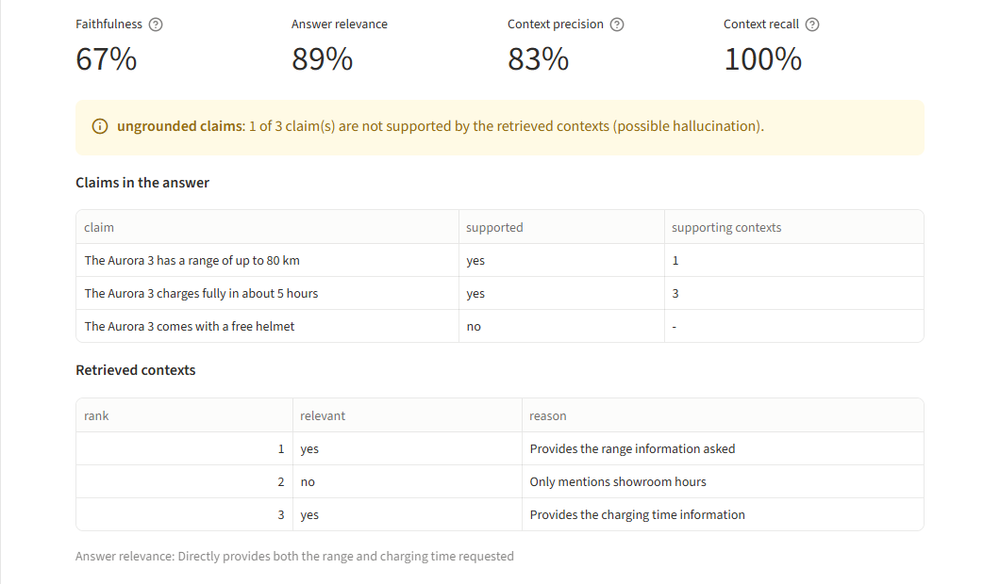
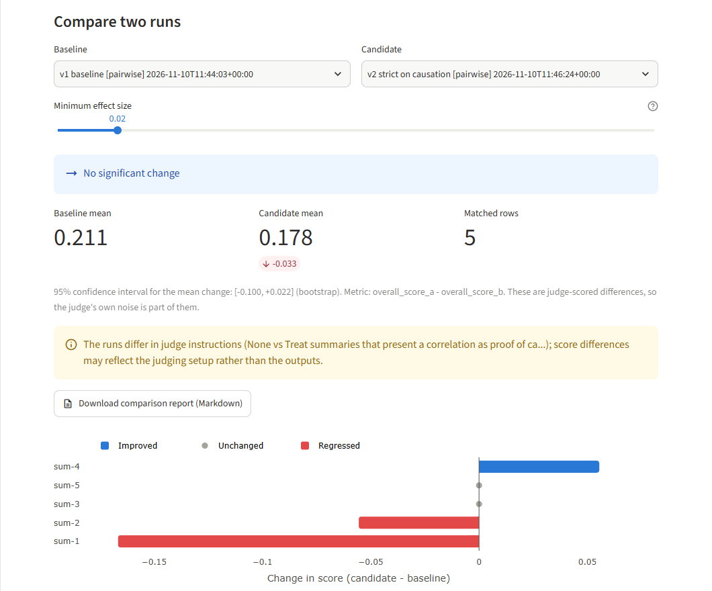
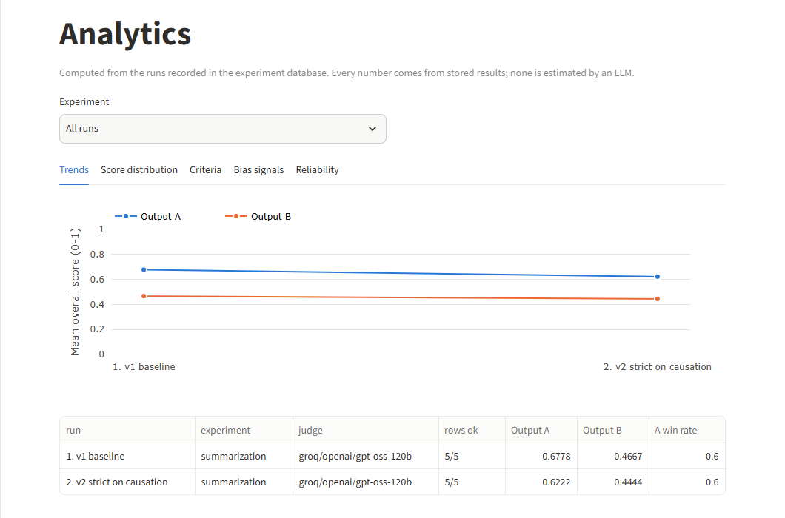
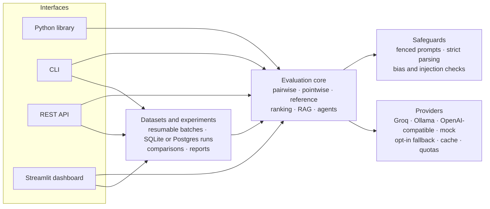

# LLM-as-Judge

An open-source platform for **evaluating LLM outputs with an LLM judge**:
pairwise comparison, pointwise and reference-based grading, multi-candidate
ranking, and RAG and agent evaluation, with position-bias mitigation and
reliability analytics. One engine powers a **Python library**, a **CLI**, a
**REST API** and a **Streamlit dashboard**. It runs on free tiers
([Groq](https://groq.com), with `openai/gpt-oss-120b` by default), on local
models with [Ollama](https://ollama.com), or entirely offline with a clearly
labelled mock judge.

[](https://llm-as-judge.streamlit.app/)
[](https://github.com/syed-waleed-ahmed/LLM-as-Judge/actions/workflows/ci.yml)
[](https://github.com/syed-waleed-ahmed/LLM-as-Judge/actions/workflows/docs.yml)
[](https://github.com/syed-waleed-ahmed/LLM-as-Judge/actions/workflows/codeql.yml)
[](https://github.com/syed-waleed-ahmed/LLM-as-Judge/actions/workflows/live-ollama.yml)
[](https://syed-waleed-ahmed.github.io/LLM-as-Judge/)
[](https://github.com/syed-waleed-ahmed/LLM-as-Judge/releases)
[](https://pypi.org/project/llm-as-judge-platform/)

[](LICENSE)

**[Live demo](https://llm-as-judge.streamlit.app/)** ·
**[Documentation](https://syed-waleed-ahmed.github.io/LLM-as-Judge/)** ·
[Getting started](https://syed-waleed-ahmed.github.io/LLM-as-Judge/getting-started/) ·
[Changelog](CHANGELOG.md) ·
[Contributing](CONTRIBUTING.md)

---

## Contents

- [Why this exists](#why-this-exists)
- [Features](#features)
- [Screenshots](#screenshots)
- [Installation](#installation)
- [Usage](#usage)
- [Reliability safeguards](#reliability-safeguards)
- [RAG, agents and judge reliability](#rag-agents-and-judge-reliability)
- [Datasets, batches and benchmarks](#datasets-batches-and-benchmarks)
- [Configuration](#configuration)
- [Providers](#providers)
- [Architecture](#architecture)
- [Technology stack](#technology-stack)
- [Development](#development)
- [Security](#security)
- [Contributing](#contributing)
- [Limitations](#limitations)
- [Roadmap](#roadmap)
- [Citing](#citing)
- [License](#license)

More documents: [Deployment](DEPLOYMENT.md) ·
[Architecture](ARCHITECTURE.md) · [API reference](API_REFERENCE.md) ·
[Benchmarks](BENCHMARKS.md) · [Security policy](SECURITY.md)

---

<!-- --8<-- [start:intro] -->
## Why this exists

"LLM-as-Judge" is a common pattern for scoring subjective qualities — creativity,
tone, code readability, factual accuracy — where there is no exact-match ground
truth. Doing it *well* in production requires more than a single API call, and
this project handles the parts that usually get skipped:

- **Structured, validated output.** The judge is pinned to a strict JSON schema
  (via the provider's JSON mode), and every response is validated with Pydantic.
  The returned criteria must match the requested ones exactly. A malformed
  reply gets a bounded "repair" retry that tells the judge what was wrong.
- **Position-bias mitigation.** LLM judges tend to favour whichever answer is
  shown first. Optionally, each pair is judged in *both* orders (concurrently)
  and the scores are averaged, cancelling that bias. The explanations shown
  always agree with the averaged verdict.
- **Self-consistency.** Out-of-range scores are clamped (and flagged), and
  winners are recomputed from the numbers, so the verdict never contradicts the
  scores. Criteria on different scales are normalised before they're combined.
- **Injection resistance.** Candidate outputs are treated as untrusted data,
  wrapped in boundary markers that carry a random per-request token.
- **Bias diagnostics.** Results carry warnings for suspected prompt injection,
  verbosity bias, self-preference risk and order-dependent verdicts.
- **Resilience.** Transient provider failures (rate limits, timeouts, 5xx) are
  retried with exponential backoff; permanent errors fail fast.
- **Scale.** A concurrent batch runner grades thousands of rows from CSV/JSONL,
  isolating per-row failures so one bad row never aborts the run.

<!-- --8<-- [end:intro] -->
---

<!-- --8<-- [start:features] -->
## Features

| Capability | Description |
|---|---|
| **Library, CLI, UI & REST API** | One evaluation core, four ways to use it. |
| **Evaluation modes** | Pairwise (A vs B), pointwise, reference-based, multi-candidate ranking, RAG (faithfulness, context precision/recall) and agent trajectories. |
| **Judge reliability** | Repeated-judgment consistency with confidence intervals; inter-judge agreement (Cohen's kappa, Spearman). |
| **Multi-criteria** | Score on several criteria at once (built-in or custom), with optional weights. |
| **Bias mitigation** | Optional A/B order swapping to reduce position bias. |
| **Reliability warnings** | Flags prompt injection, verbosity bias, self-preference and order sensitivity. |
| **Retries & repair** | Backoff for transient errors; repair retries for malformed replies. |
| **Experiment tracking** | Run history in SQLite (default) or PostgreSQL/Supabase, run comparison with confidence intervals, Markdown reports, and a regression gate for CI. |
| **Datasets & batches** | CSV/JSON/JSONL/YAML validation, checkpointed and resumable batch runs, per-model summaries, bundled benchmark samples. |
| **Fully tested** | Offline unit and property-based tests (Hypothesis) with no network calls, plus CI jobs against a real PostgreSQL server and live Ollama models. |
| **Pluggable providers** | Groq, Ollama (local), any OpenAI-compatible API, and an offline mock; add your own by implementing one method. |
| **Typed & linted** | Pydantic models, `mypy`-clean, `ruff`-clean and `ruff format`-clean. |

<!-- --8<-- [end:features] -->
---

## Screenshots

The dashboard with the live Groq judge (`openai/gpt-oss-120b`). Try it in the
[live demo](https://llm-as-judge.streamlit.app/).

| | |
|---|---|
|  |  |
| **Playground.** A pairwise verdict with per-criterion scores, explanations and a verbosity-bias warning. | **RAG evaluation.** Faithfulness, relevance and context metrics, with a verdict for every claim. |
|  |  |
| **Experiments.** A regression check between two recorded runs, with a confidence interval and a caveat that their judge instructions differ. | **Analytics.** Score trends across recorded runs, computed only from stored results. |

---

<!-- --8<-- [start:install] -->
## Installation

Python 3.11 or later is required. The package is on PyPI as
[`llm-as-judge-platform`](https://pypi.org/project/llm-as-judge-platform/); it
installs the `llm_judge` library and the `llm-judge` command:

```bash
pip install llm-as-judge-platform              # library and CLI
pip install "llm-as-judge-platform[all]"       # plus dashboard, REST API, YAML, PostgreSQL
```

To run the dashboard or work on the code, clone the repository:

```bash
git clone https://github.com/syed-waleed-ahmed/LLM-as-Judge.git
cd LLM-as-Judge

python -m venv .venv
# Windows:  .venv\Scripts\activate
# Unix:     source .venv/bin/activate

# Library + UI + dev tooling
pip install -e ".[ui,dev]"

# Or everything (UI, REST API, YAML, PostgreSQL)
pip install -e ".[all]"
```

Every [GitHub Release](https://github.com/syed-waleed-ahmed/LLM-as-Judge/releases)
also has the wheel and sdist attached. The dashboard lives in `app.py` and
`dashboard/`, so it runs from a clone.

Upgrading an environment from before 2.3.0? The distribution was renamed
from `llm-as-judge`, so remove the old one first with
`pip uninstall llm-as-judge`. Otherwise its files can shadow the new install.

Then configure your key:

```bash
cp .env.example .env      # then edit .env and set GROQ_API_KEY
```

Get a free key at <https://console.groq.com/keys>. No key yet? Every
command works offline with `--provider mock`, a deterministic heuristic judge
(clearly labelled, not an LLM), or locally with `--provider ollama`.

<!-- --8<-- [end:install] -->
---

<!-- --8<-- [start:usage] -->
## Usage

### 1. Web app (Streamlit)

```bash
streamlit run app.py
```

A multi-page dashboard over the same engine:

| Page | What it does |
|---|---|
| **Overview** | Which judge is active, session and stored-run statistics, recent runs |
| **Playground** | Compare two outputs, grade one, check against a reference, or rank candidates, with optional judge instructions, charts, explanations and warnings |
| **Datasets** | Upload CSV/JSON/JSONL/YAML (or pick a sample), validate, evaluate, chart and download results |
| **Benchmarks** | Run a bundled sample and see per-system statistics |
| **RAG evaluation** | Faithfulness, answer relevance, context precision and recall, with claim-level verdicts |
| **Agent evaluation** | Paste or upload a trace: deterministic checks plus a judged grade |
| **Experiments** | Compare two recorded runs: verdict, confidence interval, per-row changes; download Markdown reports |
| **Analytics** | Across recorded runs: score trends, score distributions, per-criterion comparison, bias signals and operational reliability |
| **Reliability** | Repeated-judgment consistency and agreement between judges |
| **Settings** | Judge temperature and tie margin for your session, provider status and health checks, limits in effect, storage, cache and privacy controls |
| **About** | How the results stay honest, privacy, how to run it yourself |

The sidebar switches between the **live judge** (when a key is configured) and
the **offline mock judge**. The mock judge works without any key, and its
results are always labelled as not coming from an LLM. Charts use a
colorblind-validated palette with separate light and dark versions.

For a public deployment, set `JUDGE_DEMO_MODE=true`. That adds per-session
and daily live-call budgets and input caps, and keeps each visitor's data
session-only. See [`DEPLOYMENT.md`](DEPLOYMENT.md) for free Streamlit
Community Cloud hosting.

### 2. Command line

```bash
# List built-in criteria (no API key required)
llm-judge list-criteria

# Judge a single pair
llm-judge evaluate \
  --task "Write a friendly tweet announcing our new AI tool" \
  --output-a "Meet our new AI assistant - it saves you hours every week. Try it free!" \
  --output-b "We have released a new artificial intelligence product." \
  --criteria "Creativity,Brand Tone Adherence" \
  --mitigate-bias

# Weight criteria and record which models produced each output
llm-judge evaluate --task-file task.txt \
  --output-a-file a.txt --output-b-file b.txt \
  --criteria "Helpfulness,Conciseness" --weights "Helpfulness=2" \
  --model-a gpt-4o --model-b llama-3.1-8b-instant

# Read long inputs from files and emit raw JSON
llm-judge evaluate --task-file task.txt \
  --output-a-file a.txt --output-b-file b.txt --json

# Give the judge your own guidance (also: grade, rank, batch, benchmark)
llm-judge evaluate --task-file task.txt \
  --output-a-file a.txt --output-b-file b.txt \
  --instructions "Penalise answers that state facts without a source."

# Grade a whole dataset concurrently (checkpointed; resumable with --resume)
llm-judge batch --input examples/sample_batch.csv \
  --output results.csv --criteria Helpfulness --workers 8

# Run a bundled benchmark sample and print per-model statistics
llm-judge benchmark summarization

# Grade one output on its own, or against an expected answer
llm-judge grade --task "Explain DNS" --output-file answer.txt
llm-judge grade --task "When did Apollo 11 land?" \
  --output "In 1969." --reference "Apollo 11 landed on the Moon on 20 July 1969."

# Rank several candidates (round robin, or --strategy pointwise for fewer calls)
llm-judge rank --task "Write a tagline" --candidates-file candidates.json
```

`candidates.json` is either `{"id": "text", ...}` or a list of
`{"id": ..., "output": ..., "model": ...}` objects.

### 3. Python library

```python
from llm_judge import Criterion, Judge, resolve_criterion

judge = Judge()  # reads config from environment / .env

result = judge.evaluate(
    task_description="Summarise the text in one sentence.",
    output_a="A concise, accurate one-line summary.",
    output_b="A rambling three-paragraph response.",
    criteria=["Helpfulness", "Conciseness"],
    candidate_a_model="gpt-4o",  # optional; recorded in metadata
)

print(result.overall_winner)  # Winner.A
print(result.overall_score_a)  # weighted, scale-normalised score (0-1)
for warning in result.warnings:  # reliability signals worth a second look
    print(warning.code, warning.message)

# Custom criteria can set their own scale and weight.
coverage = Criterion(
    name="Coverage", description="Covers every key point.", scale_min=0, scale_max=100, weight=2
)
judge.evaluate("...", "...", "...", [resolve_criterion("Helpfulness"), coverage])

# Optional guidance for the judge: how strictly to score, what to penalise.
# It's recorded in result.metadata["instructions"] and in experiment runs.
judge.evaluate(
    "...",
    "...",
    "...",
    "Accuracy",
    instructions="Penalise answers that state facts without a source.",
)
```

The same `Judge` also grades single outputs and ranks candidates:

```python
# Pointwise: grade one output on its own merits.
grade = judge.evaluate_pointwise("Explain DNS.", answer, ["Helpfulness", "Conciseness"])
print(grade.overall_score, grade.feedback)

# Reference-based: compare with an expected answer (defaults to Correctness + Completeness).
check = judge.evaluate_reference("When did Apollo 11 land?", "In 1968.", reference="20 July 1969.")
print(check.unsupported_claims)  # hallucination indicators
print(check.missing_information)  # key points the output omits
print(check.reference_metrics)  # exact_match, token_f1, optional semantic_similarity

# Ranking: round robin (every pair head to head) or pointwise (cheaper).
ranking = judge.rank("Write a tagline", {"v1": "...", "v2": "...", "v3": "..."})
for row in ranking.leaderboard:
    print(row.rank, row.candidate, row.score, (row.wins, row.losses, row.ties))
```

Every method has an async twin (`aevaluate`, `aevaluate_pointwise`,
`aevaluate_reference`, `arank`, `aevaluate_rag`, `aevaluate_agent`). Each one
runs the evaluation in a worker thread, so you can await it from async code
without blocking the event loop, and run several concurrently:

```python
import asyncio

results = await asyncio.gather(
    judge.aevaluate(task, a, b, "Helpfulness"),
    judge.aevaluate_pointwise(task, a, "Conciseness"),
)
```

Set `JUDGE_CACHE_SIZE` (for example `256`) to reuse results of identical
evaluations: same inputs, criteria, instructions, judge and settings. The cache
is opt-in, in memory only, and used only at temperature 0. Hits are marked
`metadata["cache_hit"]`, and they don't spend provider quota. Consistency
analysis never uses it.

Every pairwise evaluation returns a validated, versioned result:

```json
{
  "schema_version": "1.3",
  "criteria": [
    {
      "criterion": "Helpfulness",
      "output_a_score": 8.0,
      "output_b_score": 3.0,
      "output_a_explanation": "Directly and accurately answers the task.",
      "output_b_explanation": "Vague and largely off-topic.",
      "winner": "A"
    }
  ],
  "overall_winner": "A",
  "overall_comment": "Output A is clearly more helpful.",
  "overall_score_a": 0.7778,
  "overall_score_b": 0.2222,
  "warnings": [],
  "metadata": {
    "model": "openai/gpt-oss-120b",
    "judge": { "provider": "groq", "model": "openai/gpt-oss-120b" },
    "candidates": { "A": { "model": "gpt-4o" }, "B": { "model": null } },
    "prompt_version": "2.1",
    "position_bias_mitigated": false,
    "latency_seconds": 0.93
  }
}
```

### 4. REST API

```bash
pip install -e ".[api]"              # from a clone; included in ".[all]"
llm-judge serve                      # http://127.0.0.1:8000, docs at /docs
```

```bash
curl -s http://127.0.0.1:8000/api/v1/evaluate/pairwise \
  -H "Content-Type: application/json" \
  -d '{"task_description": "Explain DNS", "output_a": "...", "output_b": "...",
       "criteria": ["Helpfulness", {"name": "Accuracy", "weight": 2}]}'
```

| Endpoint | Purpose |
|---|---|
| `POST /api/v1/evaluate/{pairwise,pointwise,reference,rank}` | Single evaluations |
| `POST /api/v1/evaluate/{rag,agent}` | RAG and agent-trajectory evaluation |
| `POST /api/v1/analysis/consistency`, `GET /api/v1/runs/agreement` | Judge reliability |
| `POST /api/v1/evaluate/batch` | Small synchronous batches (`JUDGE_API_MAX_BATCH_ROWS`) |
| `POST /api/v1/jobs`, `GET /api/v1/jobs/{id}[/rows]`, `DELETE /api/v1/jobs/{id}` | Background dataset jobs (bounded queue, cancellable, idempotent with `Idempotency-Key`) |
| `POST /api/v1/datasets/validate` | Validate rows or CSV/JSONL/JSON/YAML content |
| `GET /api/v1/benchmarks`, `POST /api/v1/benchmarks/{name}/jobs` | Bundled sample benchmarks |
| `GET /api/v1/experiments`, `/runs`, `/runs/{id}[/rows]`, `/runs/compare` | Experiment history and regression checks |
| `GET /api/v1/system/status`, `/providers`, `/criteria`, `/statistics`, `GET /health` | Service information |

Protections, all configurable:
- **API keys.** `JUDGE_API_KEYS` (comma-separated), sent as `X-API-Key` or `Authorization: Bearer`.
- **Admin routes.** Deleting runs and listing all jobs are disabled unless `JUDGE_API_ADMIN_KEY` is set.
- **Rate limiting.** A per-client limit, with `Retry-After` on 429.
- **Size limit.** Request bodies over the limit get a 413.
- **Concurrency cap.** Excess load gets a 503, so free-tier quotas aren't exhausted silently.

Every error uses one JSON envelope with a request id, and request logs are
structured JSON without bodies. `serve` binds to localhost by default and
warns when exposed without API keys.

No always-free host is assumed for the API. Run it locally or on your own
infrastructure. The public demo (Streamlit) doesn't depend on it.

<!-- --8<-- [end:usage] -->
---

<!-- --8<-- [start:safeguards] -->
## Reliability safeguards

| Safeguard | What it does |
|---|---|
| Neutral schema | The prompt shows the output shape with placeholders, never example scores or winners that could anchor the judge. |
| Untrusted-content boundaries | The task and outputs sit between markers that carry a random per-request token. The judge is told to treat them as data and to ignore embedded instructions. |
| Exact criteria matching | The reply must contain every requested criterion exactly once (case-insensitive). Missing, extra or duplicate criteria are rejected, never guessed. |
| Repair retries | A reply that is malformed or doesn't match the schema is sent back with the reason it was rejected, up to `JUDGE_MAX_PARSE_RETRIES` times. |
| Brace-aware recovery | JSON embedded in stray prose is recovered with a real JSON decoder, not string slicing. |
| Scale normalisation and weights | Each score is mapped to 0-1 on its own scale before the weighted overall score is computed. |
| Consistent bias merges | With mitigation on, explanations come from the ordering that agrees with the averaged verdict. When neither ordering agrees, both are kept and labelled. |

Results also carry **warnings** (they never change scores):

| Code | Meaning |
|---|---|
| `possible_prompt_injection` | An output contains text aimed at manipulating the judge. |
| `possible_verbosity_bias` | The winner is much longer than the other output (`JUDGE_VERBOSITY_RATIO`). |
| `self_preference_risk` | A candidate model is from the judge's own model family. |
| `position_inconsistent` | The verdict changed when the outputs were swapped. |
| `score_out_of_range` | The judge scored outside the scale; the score was clamped. |
| `input_truncated` | An input exceeded `JUDGE_MAX_INPUT_CHARS` and was truncated. |
| `provider_fallback` | The primary provider failed and a configured fallback (`JUDGE_FALLBACK_PROVIDERS`) answered instead. |

These signals are heuristics. A clean result doesn't prove the absence of bias
or manipulation, and a warning doesn't prove its presence.

<!-- --8<-- [end:safeguards] -->
---

<!-- --8<-- [start:rag] -->
## RAG, agents and judge reliability

### RAG evaluation

```python
result = judge.evaluate_rag(
    "What is the range of the Aurora 3?",
    contexts=["The Aurora 3 has a range of up to 80 km.", "Showroom hours: 10-18."],
    answer="Up to 80 km, and it comes with a free helmet.",
    reference="Up to 80 km.",  # optional: enables context recall
)
result.faithfulness  # 0.5: share of the answer's claims supported by the contexts
result.unsupported_claims  # ['It comes with a free helmet.']: possible hallucinations
result.context_precision  # average precision of the relevant contexts, in rank order
result.context_recall  # share of the reference covered by the contexts
result.answer_relevance  # how directly the answer addresses the question
```

The judge returns claim-level verdicts and the metrics are computed from
them, so every number can be traced back to specific claims and passages.
Retrieved passages are fenced as untrusted data and scanned for prompt
injection. CLI: `llm-judge rag --question ... --context ... --answer ...`.

### Agent evaluation

`judge.evaluate_agent(trace)` takes a framework-agnostic trace: the task, the
available tools, the ordered steps (`thought`, `tool_call`, `tool_result`,
`message`) and the final answer. It returns two separate assessments:

- **Deterministic checks.** Unknown tools, missing required arguments,
  malformed calls, failed tool results, repeated identical calls, step-budget
  overruns, expected tools never used, and a missing final answer.
- **A judged grade** on Task Completion, Tool Selection and Step Efficiency
  (configurable), optionally against a reference answer.

CLI: `llm-judge agent --trace-file trace.json`.

### Judge reliability

- `measure_consistency(judge, task, output_a=..., output_b=...)` judges the
  same input repeatedly. It reports agreement with the modal verdict, the
  spread, and a bootstrap 95% CI. At temperature 0 this only shows provider
  nondeterminism, so raise `JUDGE_TEMPERATURE` to probe sensitivity. CLI:
  `llm-judge consistency ... --samples 5 --temperature 0.7`.
- `judge_agreement(store, run_a, run_b)` compares two recorded runs over the
  same rows, typically by two different judges. It uses Cohen's kappa for
  winners, and Spearman correlation plus mean absolute difference for scores.
  CLI: `llm-judge experiments agreement <run-a> <run-b>`.

All intervals come from repeated samples. None of them is a model's
self-reported confidence or a calibrated probability.

<!-- --8<-- [end:rag] -->
---

<!-- --8<-- [start:datasets] -->
## Datasets, batches and benchmarks

`llm-judge batch` evaluates whole datasets in CSV, JSON, JSONL or YAML
(YAML needs the `yaml` extra, which `all` includes). The dataset kind is inferred
from the columns:

| Kind | Required columns | Optional |
|---|---|---|
| `pairwise` | `task_description`, `output_a`, `output_b` | `id`, `model_a`, `model_b` |
| `pointwise` | `task_description`, `output` | `id`, `model` |
| `reference` | `task_description`, `output`, `reference` | `id`, `model` |

Common column names such as `prompt`, `question`, `response` and
`ground_truth` are mapped automatically. An `id` column is optional; the row
index is used if it's missing.

```csv
id,task_description,output_a,output_b,model_a,model_b
1,Write a tagline,"Fast. Simple. Yours.","Our product is good.",system-alpha,system-beta
```

```bash
llm-judge datasets validate data.csv     # kinds, duplicates, missing values, fingerprint
llm-judge batch --input data.csv --output results.csv --workers 8
llm-judge batch --input data.csv --output results.csv --resume   # after a crash or Ctrl+C
llm-judge batch --input big.jsonl --output sample.csv --sample 200 --seed 1
```

Batch runs are built for large, flaky workloads:

- **Checkpointing.** Every finished row is appended to
  `<output>.checkpoint.jsonl` straight away. The checkpoint is deleted after a
  fully successful run and kept otherwise.
- **Resume.** `--resume` skips rows that already succeeded and retries the
  failed ones. It refuses to continue if a row changed since it was
  checkpointed, so results from two dataset versions are never mixed.
- **Bounded resources.** At most `2 x workers` requests are in flight, and
  files over `JUDGE_MAX_DATASET_BYTES` or `JUDGE_MAX_DATASET_ROWS` are rejected
  before parsing.
- **Failure isolation.** A failing row is recorded with its error and never
  aborts the run.

Each run ends with a summary: winners and **per-model win rates** for
pairwise data, and mean scores per model, mean token F1 and rows with
unsupported claims for graded data.

### Benchmarks

Nine small, original, synthetic datasets ship with the package for demos and
smoke tests: `general_qa`, `code_generation`, `summarization`, `rag`,
`instruction_following`, `safety`, `math_reasoning`, `customer_support` and
`data_extraction`. Their candidate "systems" are neutral labels, not real
models.

```bash
llm-judge datasets samples                       # list them
llm-judge benchmark safety                       # run one with the configured judge
llm-judge --provider mock benchmark general_qa   # fully offline and reproducible
llm-judge benchmark my_dataset.jsonl --output rows.csv
```

These samples are tiny, so treat their numbers as a demonstration, not as
evidence about real models.

### Experiment tracking and regression detection

Add `--experiment NAME` to `batch` or `benchmark` to record the run in a local
SQLite database (`JUDGE_DB_PATH`, default `.llm_judge/experiments.db`). That
needs no server and no account.

To share runs across machines, point `JUDGE_DB_PATH` at a PostgreSQL URL
instead. A free [Supabase](https://supabase.com) project works: install the
extra (`pip install -e ".[postgres]"`), then set
`JUDGE_DB_PATH=postgresql://postgres.<ref>:<password>@<host>:6543/postgres`,
the "Transaction pooler" connection string from the project's Connect dialog.
Tables are created on first use, and both backends store the same data.
[DEPLOYMENT.md](DEPLOYMENT.md#persistent-runs-on-supabase-optional-free)
covers choosing a pooler and keeping the tables out of Supabase's REST API.

Each run stores its per-row results with
reproducibility metadata: dataset fingerprint, judge provider and model,
prompt version, criteria, relevant settings, and the library and Python
versions. Raw task text, outputs and references are not stored, only their
hashes. Judge explanations may still quote them.

```bash
llm-judge batch --input qa_v1.jsonl --output v1.csv --experiment qa --run-name v1
llm-judge batch --input qa_v2.jsonl --output v2.csv --experiment qa --run-name v2
llm-judge experiments runs --experiment qa
llm-judge experiments compare <v1-run-id> <v2-run-id> --fail-on-regression

# A shareable Markdown report: how the run was judged, results, failures,
# reproducibility details, and (with --baseline) the comparison
llm-judge experiments report <v2-run-id> --baseline <v1-run-id> --output report.md
```

```text
  mean: 0.574 -> 0.259 (change -0.315, 95% CI [-0.556, -0.093], bootstrap)
  verdict: REGRESSION
  rows regressed: 3; rows improved: 0
    worse  qa-1: 0.667 -> 0.000
```

Rows are paired by id. The comparison reports the mean paired difference
with a seeded bootstrap 95% confidence interval (a normal approximation above
5,000 pairs), and gives a verdict of regression, improvement, no significant
change or insufficient data. It also lists the rows that moved most.
`--fail-on-regression` makes it usable as a CI gate. The runs are flagged as
not directly comparable when they used a different judge, prompt version,
criteria or bias setting.

These are judge-scored differences: the judge's own noise and biases are part
of what is measured.

<!-- --8<-- [end:datasets] -->
---

<!-- --8<-- [start:configuration] -->
## Configuration

All settings are read from the environment (or `.env`). See
[`.env.example`](.env.example).

| Variable | Default | Description |
|---|---|---|
| `JUDGE_PROVIDER` | `groq` | `groq`, `ollama`, `openai_compatible` or `mock`. |
| `GROQ_API_KEY` | — | Required for the `groq` provider. |
| `GROQ_MODEL` | `openai/gpt-oss-120b` | Groq-hosted model to use. |
| `JUDGE_OLLAMA_BASE_URL` | `http://localhost:11434` | Ollama server. |
| `JUDGE_OLLAMA_MODEL` | `llama3.2` | Local model to judge with. |
| `JUDGE_OPENAI_BASE_URL` | — | Base URL of an OpenAI-compatible API (e.g. `.../v1`). |
| `JUDGE_OPENAI_MODEL` | — | Model name on that endpoint. |
| `JUDGE_OPENAI_API_KEY` | — | Optional bearer token for that endpoint. |
| `JUDGE_OPENAI_JSON_MODE` | `true` | Send `response_format: json_object` (disable for servers that reject it). |
| `JUDGE_FALLBACK_PROVIDERS` | *(empty)* | Opt-in fallback providers, comma-separated and tried in order when the primary fails (not `mock`). |
| `JUDGE_TEMPERATURE` | `0.0` | Sampling temperature (0 = deterministic). |
| `JUDGE_REQUEST_TIMEOUT` | `60` | Per-request timeout in seconds. |
| `JUDGE_MAX_RETRIES` | `3` | Retries for transient failures. |
| `JUDGE_MAX_PARSE_RETRIES` | `1` | Repair retries for malformed or schema-violating replies. |
| `JUDGE_MITIGATE_POSITION_BIAS` | `false` | Judge each pair in both orders. |
| `JUDGE_PARALLEL_BIAS_RUNS` | `true` | Run the two orderings concurrently. |
| `JUDGE_TIE_MARGIN` | `0.06` | Normalised (0-1) score gap treated as a tie (just over half a point on a 1-10 scale). |
| `JUDGE_VERBOSITY_RATIO` | `2.0` | Length ratio at which a long winner is flagged. |
| `JUDGE_MAX_CRITERIA` | `20` | Maximum criteria per evaluation. |
| `JUDGE_MAX_CANDIDATES` | `8` | Maximum candidates per ranking (round robin makes n(n-1)/2 comparisons). |
| `JUDGE_MAX_INPUT_CHARS` | `50000` | Longer inputs are truncated (with a warning). |
| `JUDGE_MAX_INSTRUCTIONS_CHARS` | `2000` | Longest judge guidance (`instructions`); longer text is truncated with a warning. |
| `JUDGE_CACHE_SIZE` | `0` (off) | Opt-in in-memory cache of identical temperature-0 results; hits are marked `cache_hit`. |
| `JUDGE_EMBEDDINGS_PROVIDER` | *(empty)* | `ollama` or `openai_compatible`: adds embedding-based `semantic_similarity` to reference grading. |
| `JUDGE_EMBEDDINGS_MODEL` | *(empty)* | Embedding model, e.g. `nomic-embed-text` on Ollama. |
| `JUDGE_EMBEDDINGS_BASE_URL` / `JUDGE_EMBEDDINGS_API_KEY` | *(provider defaults)* | Override the embeddings endpoint and key (default: the Ollama or OpenAI-compatible settings). |
| `JUDGE_API_KEYS` | — | Comma-separated keys required by `/api/v1` (open if unset). |
| `JUDGE_API_ADMIN_KEY` | — | Enables admin routes (they're disabled if unset). |
| `JUDGE_API_RATE_LIMIT` | `60` | Requests per minute per client (0 disables). |
| `JUDGE_API_MAX_BODY_BYTES` | `1000000` | Larger request bodies get 413. |
| `JUDGE_API_MAX_CONCURRENT` | `4` | Concurrent evaluations before 503. |
| `JUDGE_API_MAX_BATCH_ROWS` / `JUDGE_API_MAX_JOB_ROWS` | `50` / `1000` | Row limits for sync batches and jobs. |
| `JUDGE_API_MAX_QUEUED_JOBS` | `10` | Waiting jobs before 429. |
| `JUDGE_API_CORS_ORIGINS` | — | Comma-separated allowed origins (CORS off if unset). |
| `JUDGE_DEMO_MODE` | `false` | Public-demo safeguards in the dashboard (quotas, caps, session-only storage). |
| `JUDGE_DEMO_SESSION_CALLS` / `JUDGE_DEMO_DAILY_CALLS` | `25` / `500` | Live judge calls per visitor session / per day. |
| `JUDGE_DEMO_MAX_INPUT_CHARS` / `_MAX_ROWS` / `_MAX_CANDIDATES` | `4000` / `25` / `5` | Demo input caps. |
| `JUDGE_DB_PATH` | `.llm_judge/experiments.db` | Experiment-tracking database: a SQLite file, or a `postgresql://` URL such as Supabase (needs the `postgres` extra). Passwords are redacted wherever it's shown. |
| `JUDGE_MAX_DATASET_BYTES` | `50000000` | Larger dataset files are rejected before parsing. |
| `JUDGE_MAX_DATASET_ROWS` | `100000` | Maximum rows per dataset. |
| `JUDGE_BATCH_MAX_WORKERS` | `4` | Concurrency for batch mode (doubled when parallel bias runs are on). |
| `LOG_LEVEL` | `INFO` | Logging verbosity. |

<!-- --8<-- [end:configuration] -->
---

<!-- --8<-- [start:providers] -->
## Providers

The judge runs on any of these backends. Pick one with `JUDGE_PROVIDER` or the
`--provider` flag. Nothing here requires a paid service.

| Provider | API key | Runs | Notes |
|---|---|---|---|
| `groq` (default) | yes ([free](https://console.groq.com/keys)) | cloud | Free plan, rate-limited per model. Default judge `openai/gpt-oss-120b`. |
| `ollama` | no | your machine | Free local models via [Ollama](https://ollama.com): `ollama pull llama3.2`. Verified live weekly in CI with `qwen2.5:1.5b`. |
| `openai_compatible` | optional | either | Any `/chat/completions` server: LM Studio, vLLM, llama.cpp, or hosted free models. Verified live against Groq's OpenAI-compatible endpoint (`https://api.groq.com/openai/v1`). |
| `mock` | no | offline | Deterministic heuristic, **not an LLM**. For demos, tests and trying the tool without a key. |

```bash
llm-judge providers                      # what's available and configured
llm-judge --provider ollama health       # reachability check, no inference
llm-judge --provider mock evaluate --task "..." --output-a "..." --output-b "..."
```

```python
from llm_judge import Judge
from llm_judge.providers import OllamaProvider, OpenAICompatibleProvider

judge = Judge(provider=OllamaProvider("qwen2.5:7b"))
judge = Judge(provider=OpenAICompatibleProvider("http://localhost:1234/v1", "local-model"))
```

Every result records which provider and model produced it (`metadata.judge`),
and the library never switches provider or model silently. Mock results say so
in every explanation.

**Fallback (opt-in).** Set `JUDGE_FALLBACK_PROVIDERS` (for example `ollama`) to
try other providers, in order, when a call to the primary one fails. It is off
by default and never silent:
- a result answered by a fallback carries a `provider_fallback` warning;
- it also carries `metadata.fallback` entries naming the provider that failed,
  the one that answered, and the error;
- `metadata.judge` keeps naming the configured judge.

Two things never trigger a fallback: an exhausted demo budget, and a reply
that fails validation (the repair retry handles that). The mock judge can't be
a fallback, because its scores aren't LLM judgments. Third-party packages can add providers through the
`llm_judge.providers` entry-point group (see `llm_judge/providers/registry.py`).

Small local models are weaker judges than large hosted ones. Expect noisier
scores and more repair retries, and prefer a judge from a different model
family than the candidates (the `self_preference_risk` warning flags this).

<!-- --8<-- [end:providers] -->
---

## Architecture



[`ARCHITECTURE.md`](ARCHITECTURE.md) has the detailed diagram, the request flow
and the design principles.

```text
src/llm_judge/           # Installable package (src layout)
├─ config.py             # Typed settings (pydantic-settings); no import-time crash
├─ models.py             # Criterion / CriterionScore / JudgeResult (validated)
├─ criteria.py           # Built-in criteria presets + resolver
├─ prompts.py            # Versioned, injection-resistant prompt construction
├─ parsing.py            # Defensive JSON → validated JudgeResult
├─ scoring.py            # Pure helpers: criteria matching, normalisation, winners
├─ diagnostics.py        # Injection, verbosity and self-preference signals
├─ judge.py              # Core engine: retries, repair, bias mitigation, merging
├─ pointwise.py          # Single-output and reference-based grading
├─ ranking.py            # Multi-candidate round-robin / pointwise leaderboards
├─ metrics.py            # Deterministic reference metrics (exact match, token F1)
├─ rag.py                # RAG verdicts -> faithfulness, context precision/recall
├─ agents.py             # Agent trace checks + judged trajectory grade
├─ reliability.py        # Consistency, Cohen's kappa, Spearman agreement
├─ batch.py              # v1 batch API (kept for compatibility)
├─ cache.py              # Opt-in in-memory cache of identical temperature-0 results
├─ csv_safety.py         # Neutralises spreadsheet formulas in exported CSV cells
├─ datasets/             # Readers, validation, checkpointed runner, summaries,
│                        #   bundled synthetic samples
├─ experiments/          # Run store (SQLite or PostgreSQL), comparison, reports
├─ api/                  # FastAPI app: routes, security, job queue (`[api]` extra)
├─ cli.py                # `llm-judge` command-line interface
├─ logging_config.py     # Opt-in logging setup
├─ py.typed              # PEP 561 marker: ships type information
└─ providers/            # Pluggable LLM backends
   ├─ base.py            #   LLMProvider protocol, health, usage counters
   ├─ registry.py        #   Name -> provider factory, plugin discovery
   ├─ fallback.py        #   Opt-in fallback chain, recorded on every result
   ├─ groq_provider.py   #   Groq (default cloud judge)
   ├─ ollama_provider.py #   Local models via Ollama
   ├─ openai_compatible.py # Any /chat/completions endpoint
   └─ mock_provider.py   #   Offline heuristic judge (not an LLM)
app.py                   # Streamlit entry point (navigation)
dashboard/               # Dashboard pages, shared components, themed charts
tests/                   # Offline unit + property tests (fake providers)
```

The judge depends only on the `LLMProvider` protocol, so supporting a new backend
means implementing a single `complete_json` method, with no changes to the
judging logic.

---

<!-- --8<-- [start:stack] -->
## Technology stack

| Area | Tools |
|---|---|
| Language and models | Python 3.11 to 3.14, fully typed (mypy); Pydantic v2 and pydantic-settings |
| LLM providers | Groq SDK; httpx for Ollama and OpenAI-compatible servers; an offline mock judge |
| Resilience | tenacity retries that follow provider rate-limit hints; opt-in fallback and result cache |
| REST API | FastAPI and Uvicorn |
| Dashboard | Streamlit and Plotly |
| Storage and data | SQLite (standard library) or PostgreSQL/Supabase (psycopg); CSV, JSON, JSONL and YAML (PyYAML) |
| Quality | pytest, Hypothesis, ruff, mypy, Bandit, pip-audit, CodeQL, pre-commit |
| Delivery | GitHub Actions, Docker, MkDocs Material on GitHub Pages, Streamlit Community Cloud |

Every runtime dependency is open source, and every hosted service has a free tier.

<!-- --8<-- [end:stack] -->

---

## Development

```bash
pip install -e ".[all,dev,docs]"   # or: make install

make check                 # lint, format check, type-check, Bandit and tests
make docs                  # build the documentation site (strict)
```

Without `make`, run the commands listed in [`CONTRIBUTING.md`](CONTRIBUTING.md).
Every test uses an in-memory fake provider, so the suite runs fully offline and
deterministically, with no API key or network access.
[`scripts/e2e_dashboard.py`](scripts/e2e_dashboard.py) additionally drives the
dashboard in a real browser (see its docstring).

---

## Security

- See [`SECURITY.md`](SECURITY.md) for the threat model: prompt injection, hostile
  datasets, CSV injection, secret leakage, quota abuse and API abuse, each with a
  tested mitigation. CI runs Bandit, `pip-audit` and CodeQL.
- `.env` is git-ignored; **never commit real keys**.
- If a key is exposed, rotate it immediately in the [Groq console](https://console.groq.com/keys).
- The library never logs secret values.

Found a vulnerability? Please report it
[privately](https://github.com/syed-waleed-ahmed/LLM-as-Judge/security/advisories/new),
not in a public issue. [`SECURITY.md`](SECURITY.md) has the full policy.

---

## Contributing

Contributions are welcome: bug reports, features, documentation, tests and new
benchmark samples.

- Open a [bug report or feature request](https://github.com/syed-waleed-ahmed/LLM-as-Judge/issues/new/choose).
- Read [`CONTRIBUTING.md`](CONTRIBUTING.md) for the setup, the quality gate and
  the pull request process.
- Everyone taking part follows the [Code of Conduct](CODE_OF_CONDUCT.md).

---

<!-- --8<-- [start:limitations] -->
## Limitations

- **LLM judges are imperfect.** Position, verbosity and self-preference bias are
  mitigated and flagged, not eliminated. Scores are judgments, not ground truth.
  The bias warnings are heuristics.
- **Free tiers have limits.** Groq's free plan caps tokens per minute and per day.
  Batches slow down when they hit the cap (retries follow Groq's own wait hints).
  The public demo caps live calls, and its app sleeps when idle.
- **The mock judge isn't an LLM.** It's a text heuristic for demos and tests,
  and it ignores judge instructions. Its results are always labelled.
- **Semantic similarity is optional.** Reference grading always combines the
  judge's correctness and completeness scores with exact match and token F1,
  which are lexical. Embedding-based semantic similarity needs an embedding
  backend (`JUDGE_EMBEDDINGS_PROVIDER`). Both embedding backends are verified
  live in CI against Ollama; Groq offers no embeddings API.
- **Single-node jobs.** REST API jobs run in an in-process queue that doesn't
  survive a restart, and nothing scales horizontally. Recorded runs can live in
  PostgreSQL or Supabase, so they can outlive a single machine.
- **The REST API isn't hosted publicly.** Run it locally or on your own
  server.

<!-- --8<-- [end:limitations] -->

---

## Roadmap

Version 2.0.0 completed the planned phases, and 2.1.0 closed the gaps a
line-by-line review of the plan found: evaluation modes, providers,
datasets, experiment tracking, the REST API, the dashboard, RAG and agent
evaluation, security hardening, and documentation. Versions 2.2.0 to 2.4.0
added a PostgreSQL/Supabase experiment store, live CI checks against Ollama,
publishing to PyPI, and security hardening driven by CodeQL. Open items are more providers and more benchmark
samples. See [`ROADMAP.md`](ROADMAP.md) for the status of each phase.

---

## Citing

If you use LLM-as-Judge in research, please cite it. GitHub's "Cite this
repository" button (from [`CITATION.cff`](CITATION.cff)) gives APA and BibTeX
formats.

---

## License

[MIT](LICENSE) © Syed Waleed Ahmed
