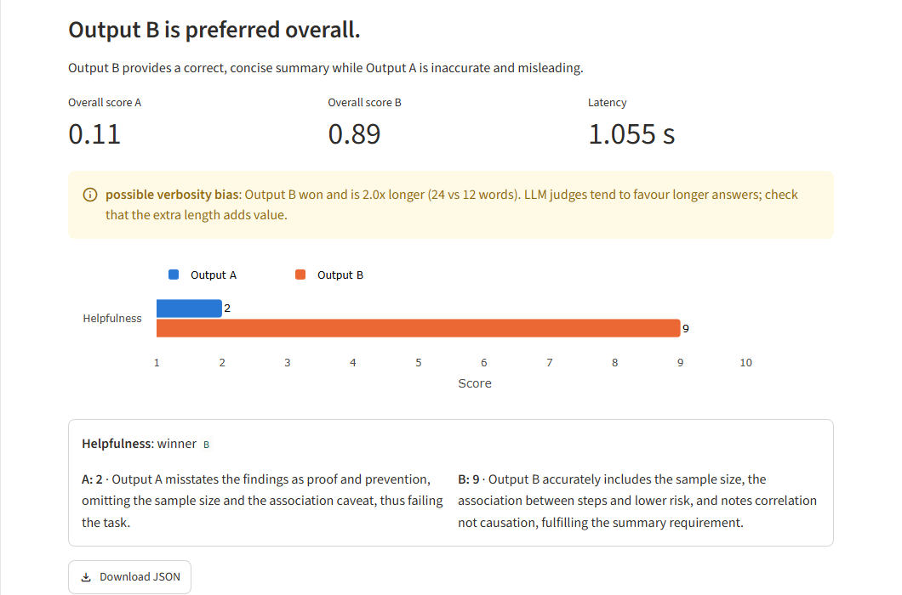
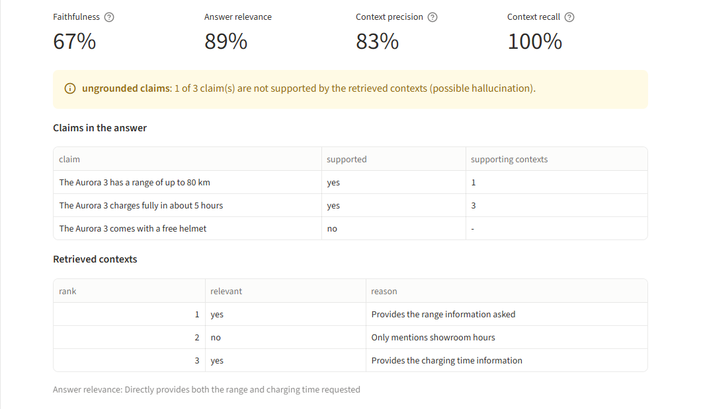
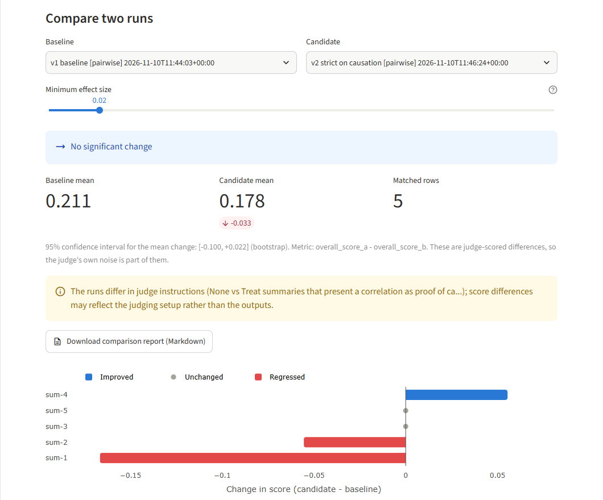
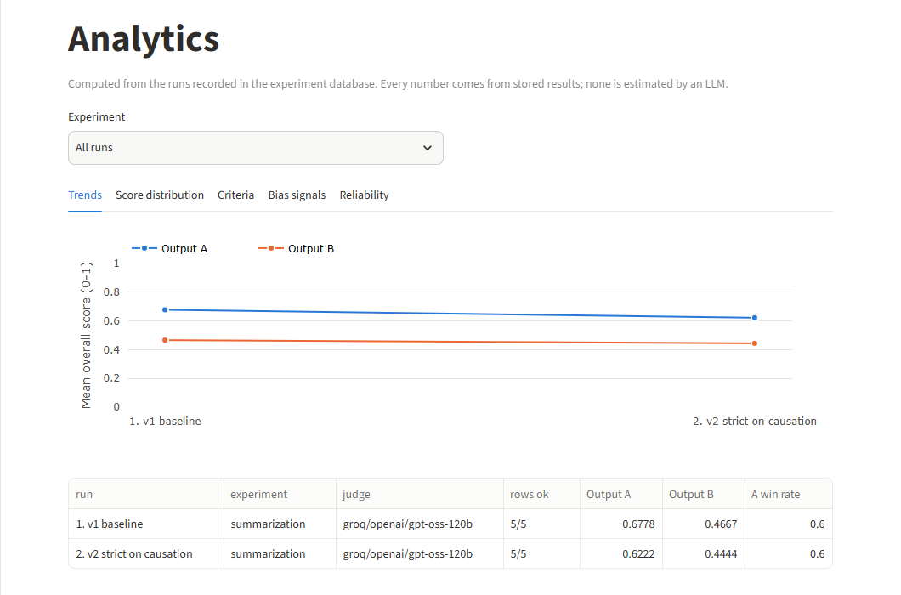

# LLM-as-Judge

An open-source platform for evaluating LLM outputs with an LLM judge. One engine
powers a **Python library**, a **CLI**, a **REST API** and a **Streamlit
dashboard**, and everything runs on free tiers or entirely offline.

[Get started](getting-started.md){ .md-button .md-button--primary }
[Live demo](https://llm-as-judge.streamlit.app/){ .md-button }
[API reference](project/api-reference.md){ .md-button }
[Source on GitHub](https://github.com/syed-waleed-ahmed/LLM-as-Judge){ .md-button }

--8<-- "README.md:intro"

--8<-- "README.md:features"

## Screenshots

The dashboard with the live Groq judge. Try it in the [live demo](https://llm-as-judge.streamlit.app/).

--8<-- "README.md:stack"

--8<-- "README.md:limitations"
